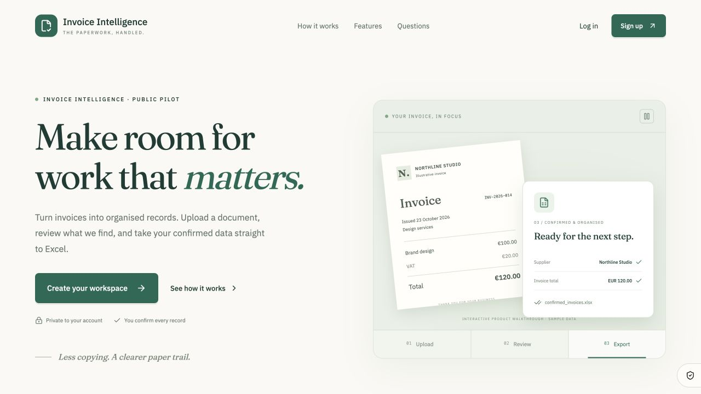
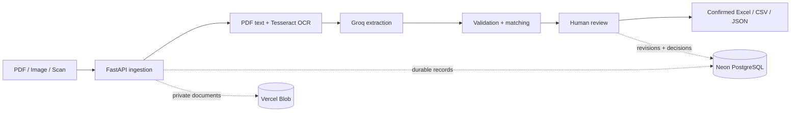

<div align="center">

# Invoice Intelligence

### From invoice to spreadsheet—with a human in control.

Upload PDFs, photos, and scanned receipts. Extract structured data, check the source, resolve exceptions, and export confirmed records to Excel.

[](https://invoice-intelligence-theta.vercel.app/)
[](src/invoice_intelligence/)
[](frontend/)

**OCR + AI extraction · Source-linked review · Private workspaces · Excel exports**

[Explore the app](https://invoice-intelligence-theta.vercel.app/) · [How it works](#how-it-works) · [Technical overview](#technical-overview) · [Run locally](#run-locally)

</div>



## The business problem

Copying invoice details into spreadsheets creates repetitive work and opportunities for mistakes. Unfamiliar supplier layouts, inconsistent totals, and duplicate documents make that work harder to automate reliably.

Invoice Intelligence brings extraction, validation, and human review into one workflow. AI prepares the record; the reviewer decides what is correct. Confirmed data can then leave the app as a usable spreadsheet.

> **A working public pilot, not just a dashboard mockup.** The live application includes a Python processing backend, persistent PostgreSQL records, private document storage, account sessions, and review history.

## How it works

| Step | What happens | What the user gets |
| :--- | :--- | :--- |
| **01 · Upload** | Submit a PDF, PNG, or JPEG. Extract PDF text or run OCR on page images. | A saved document with processing status. |
| **02 · Extract** | Groq reads invoice details and line items using the document and OCR context. | Structured fields with source evidence or explicit proposals. |
| **03 · Check** | Reconcile amounts and surface duplicate or purchase-order findings. | Exceptions that explain what needs attention. |
| **04 · Review** | Compare values with the page, correct errors, and confirm the record. | A reviewer-attributed decision and version history. |
| **05 · Export** | Download confirmed records and line items. | A genuine **Excel workbook**, plus CSV and JSON options. |

**Try the full workflow:** [Create an account](https://invoice-intelligence-theta.vercel.app/?auth=signup), upload an invoice, open its review, and download confirmed records from **Documents → Download Excel**.

## What makes this more than an OCR demo

- **Review with context.** View extracted fields beside the source page and inspect evidence highlights. Image-only proposals require explicit verification.
- **Checks before confirmation.** Arithmetic reconciliation, duplicate warnings, and purchase-order discrepancies help identify records that need a closer look.
- **Corrections with a history.** Saved revisions retain the reviewer, reason, and decision. Stale writes are rejected to protect concurrent edits.
- **Retries that respect existing work.** Upload replay and durable job state help avoid duplicate records when requests are repeated.
- **Private account workspaces.** Public accounts have separate PostgreSQL schemas for invoices, processing jobs, reviews, matching, and exports.
- **Exports you can use.** Confirmed invoices and line items are written to separate Excel sheets. Untrusted cell content is stored as text to prevent formula execution.
- **A complete public experience.** Animated product walkthrough, responsive screens, signup, login, secure cookie sessions, and accessible motion controls.
- **Consent is explicit.** Optional visitor analytics and outreach opt-in are separate from essential sign-in cookies. Users can withdraw their preferences.

Advanced purchase-order imports, duplicate decisions, review timers, and reopen/rebase controls are available in the authenticated `/legacy-review` interface. The React workspace displays matching findings; it does not yet replace every administrative control.

## Technical overview



| Layer | Implementation |
| :--- | :--- |
| **Interface** | React, TypeScript, Vite, TanStack Router, Tailwind CSS, Anime.js |
| **API & processing** | Python, FastAPI, Tesseract, PDF text extraction and page rendering |
| **AI provider** | Groq; local extraction rules remain available for offline development |
| **Cloud persistence** | Neon PostgreSQL and private Vercel Blob storage |
| **Account access** | Scrypt password hashes, opaque server-side sessions, Secure / HttpOnly / SameSite cookies |
| **Deployment** | Frontend and backend together in a Vercel container |
| **Local persistence** | SQLite and local artifacts for development |

Cloud processing runs during bounded HTTP requests. Keep the workspace open while a document processes; saved unfinished jobs can resume on a later visit. The current pilot does not include an unattended background queue.

## Verification, without inflated claims

The recorded verification snapshot includes:

| Check | Result |
| :--- | :--- |
| Backend regression tests | **173 passed** |
| Frontend tests | **14 passed** |
| Real cloud account, isolation, session, consent, and export checks | **26 passed** |
| Public-site HTTP checks | **19 passed** |
| Production frontend build | **Passed** |

A live synthetic-invoice check also exercised upload, Groq extraction, source retrieval, safe retry, and review creation. Browser checks covered public entry, signup/login navigation, explicit workspace entry, and the updated interface.

**These are functional checks, not an extraction-accuracy score.** Performance on one sample does not establish reliability across suppliers. Earlier small external evaluations exposed substantial extraction errors; the application therefore keeps human confirmation mandatory. There is no claimed percentage accuracy, measured labor-saving figure, or accounting-compliance certification.

See [live backend verification](docs/frontend/LIVE_BACKEND_VERIFICATION.md), [public account behavior](docs/frontend/PUBLIC_ACCESS.md), and [extraction improvements](docs/improvement/IMPLEMENTATION.md). Some older documents describe earlier deployment stages; this README describes the current live architecture.

## Run locally

**Requirements:** Python 3.11+ (3.12 used for cloud verification), Tesseract with English/OSD language data, and a Groq key if using AI extraction. The optional React interface also needs Node.js 22.12+ or 24 LTS.

```bash
git clone https://github.com/Saif1Shahzad/invoice-intelligence.git
cd invoice-intelligence
python3 -m venv .venv
source .venv/bin/activate
python -m pip install -e '.[dev]'
```

Install Tesseract with your system package manager, for example `brew install tesseract` on macOS or `sudo apt install tesseract-ocr tesseract-ocr-eng tesseract-ocr-osd` on Ubuntu.

Copy `.env.example` to `.env` **only if `.env` does not already exist**. Set these values locally:

```dotenv
EXTRACTION_PROVIDER=groq
GROQ_API_KEY=your_local_key
```

Use `EXTRACTION_PROVIDER=local` for offline rules without external extraction calls. Never commit `.env`, credentials, or private invoices. With Groq selected, extraction sends document page images and OCR context to the provider.

Start the API and local worker:

```bash
python -m invoice_intelligence serve --port 8000
```

Open [the local review interface](http://127.0.0.1:8000/). Stop with **Ctrl+C**.

For the React development workspace, open a second terminal:

```bash
cd frontend
npm ci
npm run dev
```

The development interface starts in sample mode. Select **Backend** to use the running local API through the frontend proxy. Public cookie accounts and managed storage belong to the cloud configuration; they are not enabled by the default local setup.

### Run the checks

```bash
# From the repository root, with the virtual environment active
python -m unittest discover -s tests -v

# From frontend/
npm test
npm run build
```

## Deployment & project structure

The live Vercel project uses **Root Directory `frontend`**, **Container** as its framework, and `frontend/Dockerfile.vercel`. It includes Tesseract and the packaged Python backend; durable data lives outside the container. Secrets stay on the server.

See the [cloud deployment guide](deploy/vercel/README.md) and [public access notes](docs/frontend/PUBLIC_ACCESS.md). Rebuild the backend wheel in `frontend/vendor` when changing Python source before deploying that container.

```text
frontend/                      React workspace and public product website
src/invoice_intelligence/      API, OCR, extraction, review, matching, persistence
src/invoice_intelligence/cloud/ PostgreSQL, private storage, public accounts
tests/                         Backend regression checks
docs/                          Architecture, evaluation, and implementation notes
deploy/                        Deployment configuration and guides
web_data/                      Local evaluation documents and responses (ignored)
```

## Current pilot limits

- **10 upload attempts per account per day**, up to **3 pages / 3.5 MB** per file; shared processing limits and provider quotas also apply.
- Human confirmation is required. Unsupported layouts, OCR errors, and ambiguous fields can still need manual correction.
- Email verification, password reset, and self-service account deletion are not yet implemented. Outreach contacts are explicitly marked unverified.
- The app does not execute payments or post records into an accounting system.

## Need a similar workflow for your business?

This project demonstrates document ingestion, OCR and LLM integration, validation rules, exception handling, human review, auditability, and cloud delivery in one application.

A tailored engagement can start with your document samples, required output fields, review rules, and target system—then evaluate extraction quality against labeled examples before expanding the workflow.

**[Explore the live product](https://invoice-intelligence-theta.vercel.app/) · [View the developer’s GitHub profile](https://github.com/Saif1Shahzad)**
